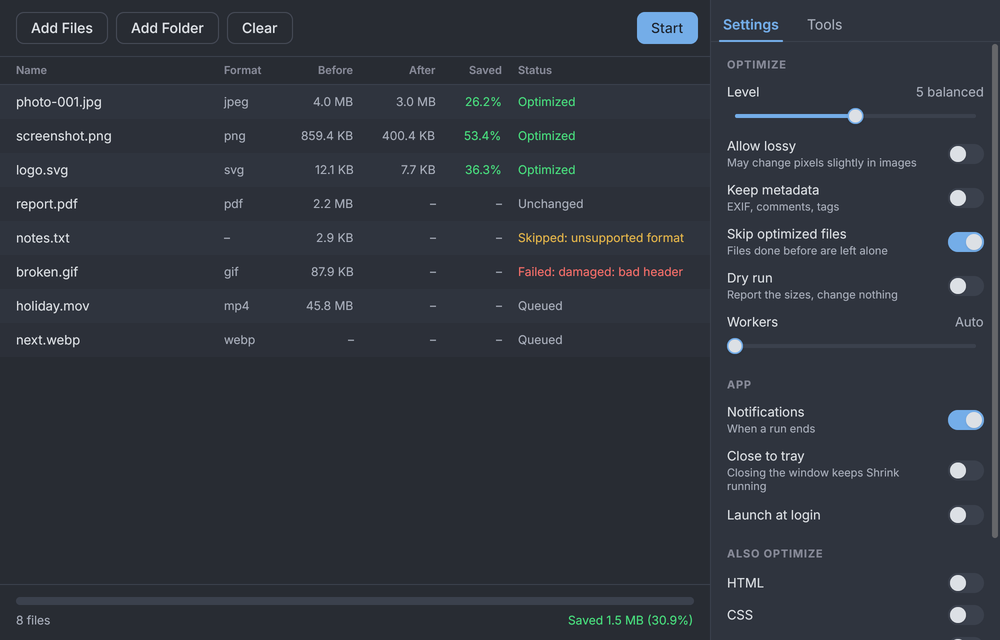

# Shrink

Makes files smaller without changing what they contain. Images, PDFs, audio, video, archives, documents, databases and more, optimized in place and checked afterwards: a result is only kept if it is smaller **and** decodes to the same content as the original.



## Install

Download the desktop app (macOS `.dmg`, Windows `-setup.exe`, Linux `.deb`, `.tar.gz` or `.AppImage`) or the single-file `shrink` command line program for your platform from [Releases](https://github.com/dunkbing/shrink/releases). No Bun needed. Builds are unsigned unless a release says otherwise: on macOS, right-click the app and choose Open the first time.

## Use it

Command line:

```sh
bun packages/cli/src/main.ts photos/ report.pdf   # files or folders
bun packages/cli/src/main.ts -n -v photos/        # dry run, show every step
```

Desktop app (drop files onto the window):

```sh
cd apps/desktop && bun start
```

The tools Shrink runs (oxipng, ffmpeg, qpdf, ...) are downloaded automatically when a file needs them.

## What it does

- **Lossless by default.** Lossy modes (`--lossy`) are opt-in and checked against a similarity floor.
- **Verified.** Every result is compared with the original by an independent check (decoded pixels, audio samples, archive members, document pages, database contents...). If the check fails, the file is left alone.
- **Safe.** Damaged, signed or encrypted files are skipped, writes are atomic, and timestamps are kept.
- **Fast.** Files run in parallel; already optimized files are skipped next time.

Supported formats and how each is checked: [docs/FORMATS.md](docs/FORMATS.md). Design: [docs/SPEC.md](docs/SPEC.md). Tools and licences: [docs/TOOLS.md](docs/TOOLS.md).

## Develop

```sh
bun install
bun run typecheck && bun test
bun run fixtures:fetch   # real sample files for the corpus tests
```

## License

[MIT](LICENSE). The bundled tools keep their own licences ([docs/THIRD_PARTY.md](docs/THIRD_PARTY.md)).
